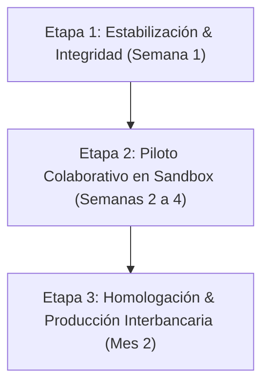

# Minuta Estratégica y Arquitectura Técnica: Reunión con Especialista en Prevención de Fraude

**Proyecto:** Consorcio Interbancario ZK & Plataforma Antifraude Federal  
**Entorno:** Preproducción / Sandbox (`antifraude-one.vercel.app`)  
**Fecha:** 22 de Octubre de 2026  
**Audiencia:** Gerencia de Prevención de Fraude & Riesgo Operativo (Consultoría Externa)

---

## a) ¿Qué hace hoy el sistema? (Lenguaje No Técnico)

El sistema opera como una **red colaborativa de defensa temprana entre entidades financieras (Bancos y Fintechs)**. Su objetivo es detectar patrones de fraude transaccional y cuentas puente ("mulas") antes de que el dinero sea retirado o transferido hacia billeteras virtuales de destino final.

### 1. Datos que se consultan y registran
- **Identificadores Transaccionales:** CBU/CVU de origen y destino, CUIT/CUIL del titular, DNI, dirección de correo electrónico, número de teléfono y hash de huella digital de dispositivo (Device Fingerprint).
- **Protección de Privacidad (Zero-Knowledge):** Ningún dato personal (PII) viaja ni se guarda en texto claro en la base de datos central. Cada identificador es procesado localmente con funciones criptográficas unidireccionales (SHA-256 + salt de red) antes de salir de la entidad. Dos bancos pueden verificar si comparten un mismo usuario sospechoso sin que ninguno conozca los datos privados de los clientes del otro.
- **Relaciones entre Entidades (Grafo de Vínculos):** Si una cuenta reportada por el Banco A por vaciamiento de fondos comparte la misma huella de dispositivo o el mismo CUIT que una cuenta recién abierta en la Fintech B, el sistema correlaciona la relación en tiempo real.

### 2. Cómo se calcula el Score de Riesgo (0 a 100)
El motor de riesgo unificado (`fraudEngine.ts`) calcula una puntuación ponderada basada en 5 pilares:
1. **Severidad y Reputación Previa:** Incidencias confirmadas en la red asociadas a los identificadores (Cuentas Mula = 90 pts base, Robo de Identidad = 75 pts, Phishing = 55 pts, etc.).
2. **Multiplicador Multientidad:** Si un mismo identificador o dispositivo aparece comprometido en 2 entidades distintas, el riesgo se multiplica por 1.25x; en 3 entidades por 1.50x; y en 4 o más entidades por 1.80x.
3. **Detección de Granjas de Dispositivos (Device Farm Floor):** Si un mismo navegador o dispositivo físico se ha vinculado a 3 o más CUITs distintos en un lapso breve, se impone un piso mínimo automático de 85 puntos (riesgo crítico).
4. **Validación Sintáctica y Reputacional de Correo Electrónico:** Verificación de formato RFC 5322, detección de proveedores descartables/temporales (+40 pts) y penalización de dominios de alta rotación sin historial corporativo.
5. **Decaimiento Temporal (Time Decay con Half-Life de 180 días):** Las incidencias antiguas pierden peso de forma logarítmica con el transcurso de los meses, evitando que un cliente quede penalizado de por vida por un incidente menor subsanado.

### 3. Decisiones que toma el sistema
A partir del score consolidado y los umbrales configurados:
- **0 a 34 puntos (BAJO / ALLOW):** Transacción legítima aprobada sin fricción.
- **35 a 74 puntos (MEDIO / REVIEW):** Requiere desafío adicional (MFA / 2FA biométrico obligatorio, retención preventiva o revisión analítica).
- **75 a 100 puntos (ALTO / BLOCK):** Alerta crítica inmediata y recomendación de bloqueo de débito/transferencia y congelamiento preventivo.

---

## b) Estado de Funcionalidades Actuales (Portal Empresa vs. Admin Consorcio)

| Módulo / Funcionalidad | Portal | Estado Actual | Observaciones y Cobertura |
| :--- | :--- | :--- | :--- |
| **Login Unificado & RBAC** | Empresa / Admin | **Funcional** | Separación de roles `admin` y `usuario`, autenticación contra Supabase, soporte 2FA TOTP y cierre de sesión por inactividad (15 min). |
| **Consulta Individual ZK (Risk Lookup)** | Empresa | **Funcional** | Evaluación de DNI, CUIT, CBU, Email y Dispositivo con normalización y hash instantáneo. Genera log de auditoría inmutable. |
| **Carga Masiva de Fraude (CSV / JSON)** | Empresa | **Funcional** | Ingesta masiva de reportes con vinculación automática de aristas de grafo. |
| **Historial de Consultas & Auditoría** | Empresa | **Funcional** | Tabla con filtros por fecha, estado y actor. Cumplimiento BCRA. |
| **Tarjetas KPI Superiores** | Empresa | **En Proceso** | Requiere segregación diaria estricta y reemplazo de métricas históricas por estado de consultas del día. |
| **Gráfico de Evolución Semanal** | Empresa | **En Proceso** | Necesita representación formal de 7 días reales (0s en días vacíos). |
| **Laboratorio de Scoring (Scoring Lab)** | Admin Consorcio | **Parcial** | Permite editar umbrales, pesos de severidad y penalidades; falta persistencia activa por 404 en `scoring_config`. |
| **Gestión de Entidades Participantes** | Admin Consorcio | **Funcional** | Alta, baja lógica, regeneración de claves API y asignación de índice de confianza (`trust_weight`). |
| **Gestión de Usuarios (RBAC)** | Admin Consorcio | **Parcial** | Interfaz terminada; requiere tabla `app_users` creada en base remota para persistir usuarios. |
| **Red de Alertas Interbancarias** | Admin Consorcio | **Funcional** | Emisión y cierre de alertas tempranas con difusión a miembros suscritos. |
| **Asistente "Centinela AI"** | Ambos | **Funcional / Demo** | Chat drawer explicativo de riesgos e interpretabilidad de incidencias. |
| **Recorrido de Mulas a 3 Saltos (RPC)** | Motor | **Parcial (Fallback local)** | Motor ejecuta búsqueda en memoria; falta función SQL recursiva `traverse_mule_network` en base de datos. |

---

## c) Limitaciones y Riesgos Detectados

1. **Persistencia de Esquema en Backend:**
   - Las tablas `app_users` y `scoring_config` no fueron creadas aún en la instancia de Supabase de producción, generando errores 404 en la consola y obligando a la aplicación a recurrir a valores de memoria o predeterminados.
2. **Datos Históricos vs. Indicadores Diarios en Dashboard:**
   - La vista actual computaba totales históricos acumulados de la base de datos (58 reportes, 53 fraudes) en lugar de filtrar las consultas e incidentes ocurridos estrictamente en la fecha (`today`).
3. **Cálculo de Tasa Crítica Desalineado:**
   - Se producía una división entre dos magnitudes no comparables (53 aristas de fraude históricas sobre 32 consultas de prueba), generando porcentajes anómalos superiores al 100%.
4. **Protección de Datos y Regulaciones (Ley 25.326 de Protección de Datos Personales / GDPR):**
   - Si bien los identificadores se hashean con SHA-256 + salt, un diccionario de DNIs o teléfonos de un país completo puede sufrir ataques de fuerza bruta si el salt no se rota o no se custodia bajo un módulo HSM / KMS bancario dedicado.
5. **Falsos Positivos en Red:**
   - Si una entidad clasifica erróneamente una cuenta como mula, puede perjudicar la operativa de un cliente en los demás bancos del consorcio si no existe un protocolo formal de "Desestimación / Reclamación de Falso Positivo" con actualización de score en tiempo real.

---

## d) Puntos de Mejora Priorizados y Esfuerzo Estimado

| Prioridad | Mejora Técnica / Operativa | Esfuerzo Estimado | Justificación |
| :---: | :--- | :---: | :--- |
| **ALTA** | Creación y migración de tablas faltantes (`app_users`, `scoring_config`, `traverse_mule_network`) con RLS y recarga de schema cache. | 1 a 2 horas | Elimina los errores 404 en consola y habilita la persistencia real de usuarios y umbrales. |
| **ALTA** | Normalización de KPIs superiores: Consultas del día con desglose Aprobadas / Revisión / Rechazadas y Tasa Crítica acotada (0-100%). | 2 a 3 horas | Brinda métricas operativas fidedignas para la toma de decisiones sin datos residuales. |
| **ALTA** | Gráfico semanal con trazabilidad de 7 días continuos y manejo de estados vacíos (0 consultas = estado neutral claro). | 2 horas | Garantiza fidelidad visual sin deformaciones gráficas. |
| **MEDIA** | Health Check real de latencia y estado de WebSocket Realtime en reemplazo de etiquetas estáticas. | 2 a 3 horas | Confiabilidad operativa para monitoreo de SLAs en auditoría. |
| **MEDIA** | Flujo formal de disputa y remediación de Falsos Positivos con firma criptográfica de la entidad emisora. | 1 a 2 días | Requisito indispensable para evitar bloqueos indebidos de usuarios legítimos. |
| **BAJA** | Integración con HSM bancario para gestión de sales criptográficas rotativas. | 3 a 5 días | Escalabilidad y cumplimiento estricto para homologación bancaria nivel Tier 1. |

---

## e) Preguntas Clave para la Experta en Fraude (Guía de Entrevista)

1. **Tipologías y Señales de Fraude:**
   - *¿Cuáles son los 3 patrones de fraude de mayor impacto hoy en el sistema financiero local (vishing, suplantación de identidad para créditos online, apertura de cuentas mula, phishing previsional)?*
   - *¿Qué identificador consideran más determinante al momento de inferir una cuenta mula: el CBU/CVU de destino o la huella de dispositivo compartido?*

2. **Definición y Validación de "Fraude Confirmado":**
   - *¿Qué estándar de prueba interno exige una entidad para catalogar un caso como "Fraude Confirmado" y compartirlo en una red interbancaria?*
   - *¿Cómo gestionan el riesgo de compartir un reporte preventivo prematuro que luego resulte ser una operación legítima del titular?*

3. **Tolerancia a Falsos Positivos vs. Falsos Negativos:**
   - *¿Qué tasa de falso positivo es tolerable en transferencias inmediatas antes de que el costo operativo de soporte al cliente supere las pérdidas por fraude?*
   - *¿Prefieren un modelo con alto recall (detectar todo a costa de más revisiones manuales) o alta precisión (solo bloquear ante certeza absoluta)?*

4. **Bloqueo Automático vs. Fricción Dinámica:**
   - *En transacciones de alto riesgo (>75 puntos), ¿recomienda el bloqueo automático de fondos o la degradación a un canal de verificación obligatoria (biometría facial / diferimiento de acreditación por 2 horas)?*

5. **Gobernanza y Cumplimiento Normativo:**
   - *¿Cómo ven la recepción del esquema Zero-Knowledge frente a auditorías de BCRA / UIF? ¿Consideran necesario conservar la trazabilidad de qué analista efectuó cada consulta?*

6. **Calibración y Datos para Entrenamiento:**
   - *¿Con qué frecuencia calibran habitualmente las matrices de riesgo (semanal, mensual)? ¿Tienen datasets anonimizados o métricas de contracargos con las que podamos contrastar la matriz de scoring actual?*

---

## f) Propuesta de Próximos Pasos y Roadmap en 3 Etapas

### Etapa 1: Estabilización & Integridad del Sandbox (Semana 1)
- Ejecución de migraciones DDL en Supabase (`app_users`, `scoring_config`, función RPC `traverse_mule_network`).
- Despliegue de tarjetas dinámicas con métricas estrictamente del día y desglose por resultado (Aprobadas / Revisión / Rechazadas).
- Verificación de consola limpia (cero errores 404, reintentos con backoff y medición de latencia en vivo).

### Etapa 2: Piloto Colaborativo en Sandbox con Entidades Simuladas (Semanas 2 a 4)
- Conexión de 3 entidades financieras simuladas (Banco Tradicional, Billetera Digital y Plataforma E-commerce).
- Simulación de un ataque de vaciamiento cruzado con granjas de dispositivos distribuidas para calibrar el multiplicador multientidad y el piso de granjas.
- Taller de calibración con analistas de fraude para ajustar los umbrales de alerta y pesos de penalización de correos temporales.

### Etapa 3: Homologación de Seguridad, Gobernanza & Salida a Producción (Mes 2)
- Implementación de protocolo formal de desestimación de falsos positivos y auditoría criptográfica inmutable.
- Auditoría de ciberseguridad externa (PenTest, cumplimiento de secreto bancario y verificación de irreversibilidad de hashes ZK).
- Homologación técnica de APIs REST y WebSockets para integración con los core bancarios de los participantes.
