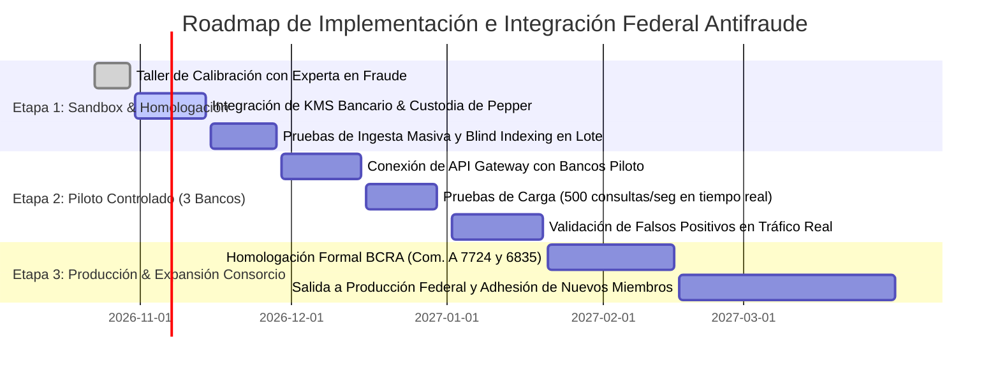

# Minuta Ejecutiva y Documento Estratégico: Reunión con Gerencia de Prevención de Fraude

**Proyecto:** Consorcio Interbancario & Red Federal de Inteligencia Antifraude  
**Plataforma:** Preproducción / Sandbox Oficial ([antifraude-one.vercel.app](https://antifraude-one.vercel.app/))  
**Fecha de Reunión:** Octubre de 2026  
**Destinatarios:** Gerencia de Prevención de Fraude, Riesgo Operativo y Seguridad de la Información (CISO)  
**Propósito:** Presentación de capacidades operativas, validación de criterios de scoring, alineación regulatoria y acuerdos de gobernanza para homologación bancaria.

---

## a) ¿Qué hace hoy el sistema? (Lenguaje No Técnico)

El sistema es una **red de alerta temprana y defensa colaborativa entre entidades financieras (Bancos, Fintechs y PSPs)** que permite detectar y frenar estafas, suplantaciones de identidad y cuentas puente ("mulas") en tiempo real, antes de que los fondos sean extraídos o convertidos.

### 1. Datos que se consultan y analizan
* **Identificadores Transaccionales:**
  * **CBU / CVU:** Clave bancaria o virtual de 22 dígitos (con validación de estructura Módulo 10 del BCRA).
  * **CUIT / CUIL / CDI:** Identificador tributario (con validación de dígito verificador Módulo 11 de AFIP).
  * **DNI:** Documento de identidad nacional (6 a 9 dígitos numéricos).
  * **Email:** Correo electrónico corporativo o personal (con chequeo sintáctico RFC 5322 y validación MX en vivo).
  * **Teléfono:** Número celular o fijo en formato internacional E.164.
  * **Huella Digital del Dispositivo (Device ID):** Identificador unívoco del hardware/navegador que ejecuta la operación.
  * **Dirección IP:** Punto de conexión de red para correlación geográfica y anomalías.

* **Privacidad y Secreto Bancario (Blind Indexing Irreversible):**
  Ningún dato personal (PII) se almacena ni viaja en texto claro por la red del consorcio. Antes de transmitirse, cada dato se transforma en un **Token Ciego Determinístico (HMAC-SHA256 con Pepper Secreto custodiado en HSM/KMS y Separación de Dominio)**. Esto permite que dos bancos identifiquen si una misma cuenta o DNI está operando en ambos sin que ninguno conozca los clientes del otro.

### 2. Cómo se calcula el Score de Riesgo (0 a 100)
El motor de riesgo ponderado (`fraudEngine.ts`) evalúa cada consulta combinando 5 dimensiones matemáticas:
1. **Severidad del Antecedente:** Gravedad de los reportes previos asociados al identificador (Cuenta Mula: 90 pts, Fraude Confirmado: 95 pts, Robo de Identidad: 80 pts, Phishing: 60 pts, Movimiento Sospechoso: 40 pts).
2. **Multiplicador Multientidad (Efecto Red):** Si un identificador aparece comprometido en 2 entidades distintas, el score se multiplica por **1.25x**; en 3 entidades por **1.50x**; y en 4 o más entidades por **1.80x**.
3. **Piso Crítico por Granja de Dispositivos (Device Farm Floor):** Si un mismo dispositivo físico o navegador se ha vinculado a 3 o más CUITs distintos en un lapso breve, el motor impone un **piso mínimo automático de 85 puntos** (Riesgo Crítico).
4. **Inteligencia de Correo Electrónico:** Penalización por correos de proveedores temporales/descartables (+40 pts) o dominios sin registro MX (+35 pts).
5. **Decaimiento Temporal (Time Decay con vida media de 180 días):** Las incidencias pierden peso de forma logarítmica con el paso de los meses. Si un titular no registra nuevos incidentes, su score disminuye progresivamente para evitar penalizaciones vitalicias indebidas.

### 3. Decisiones y Recomendaciones Operativas que toma el sistema
* **0 a 34 puntos (BAJO RIESGO / APROBAR):**
  * *Acción:* La transacción o alta de cuenta se aprueba sin fricción. No se detectan anomalías ni coincidencias en la red.
* **35 a 74 puntos (RIESGO MEDIO / REVISIÓN MANUAL):**
  * *Acción:* Se sugiere fricción dinámica: Desafío de Segundo Factor (2FA / biometría facial obligatoria), diferimiento de acreditación por 2 horas o derivación a la cola de analistas de fraude.
* **75 a 100 puntos (RIESGO CRÍTICO / BLOQUEAR):**
  * *Acción:* Recomendación de **bloqueo automático** preventivo de la transferencia o congelamiento de fondos, con generación de alerta temprana para el resto del consorcio.

---

## b) Funcionalidades Actuales y Estado de Madurez

### Portal Empresa / Entidades Bancarias (`#partner-portal` / `/bancos`)
Acceso para operadores y analistas de fraude de cada banco participante:

| Funcionalidad | Descripción | Estado |
| :--- | :--- | :---: |
| **Consulta de Riesgo Individual** | Búsqueda por DNI, CBU/CVU, Email, Teléfono, IP o Device con autodetección, atajo Enter y validaciones BCRA/AFIP en tiempo real. | **Funciona** |
| **Separación Visual de Riesgo** | Presentación paralela en dos columnas: *Riesgo Propio* (antecedentes internos del banco) vs *Riesgo en Red* (consorcio interbancario). | **Funciona** |
| **Explicabilidad del Score** | Desglose de motivos del score, nivel de confianza (Alto/Medio/Bajo), recencia del último reporte y cantidad de entidades reportantes anónimas. | **Funciona** |
| **Reporte de Fraude en 2 Pasos** | Modal de previsualización que muestra los tokens ciegos generados y metadatos antes de enviar el incidente al consorcio. | **Funciona** |
| **Rectificación / Desmarque Inmediato** | Pantalla de confirmación con botón para retirar voluntariamente un reporte erróneo (borrado $O(1)$ en Cuckoo Filter y actualización en BD). | **Funciona** |
| **Dashboard Operativo en Vivo** | Tarjetas de métricas calculadas sobre el día actual: Consultas por Resultado (Aprobadas/Revisión/Rechazadas), volumen del día y Tasa Crítica acotada [0-100%]. | **Funciona** |
| **Gráfico de Evolución Semanal** | Gráfico continuo de 7 días naturales (con 0 en días sin actividad) correlacionando Consultas vs Detecciones Críticas. | **Funciona** |
| **Evaluación por Lote (CSV Batch)** | Carga masiva de transferencias en archivo CSV para scoring automatizado. | **Parcial** *(Procesa en cliente, falta endpoint masivo asíncrono en backend)* |
| **Credenciales y API Keys** | Visualización de claves de integración institucional y documentación de cabeceras seguras. | **Funciona** |
| **Modo Demostración Rápida** | Selector colapsado de casos preconfigurados (DNI Mula, CBU Comprometido) para presentaciones. | **Demo** *(Diseñado para pruebas)* |

### Portal de Gobernanza Central / Consorcio (`#admin-portal` / `/admin`)
Acceso exclusivo para administradores de la red y gobernanza federal:

| Funcionalidad | Descripción | Estado |
| :--- | :--- | :---: |
| **Autenticación con 2FA TOTP RFC 6238** | Inicio de sesión con contraseña maestra y código dinámico obligatorio de Google Authenticator / Authy con persistencia permanente en base de datos. | **Funciona** |
| **Gestión de Entidades Miembros** | Alta, monitoreo, asignación de ponderación de confianza (*Trust Weight*) y cuarentena administrativa inmediata de bancos participantes. | **Funciona** |
| **Cuarentena Administrativa en Tiempo Real** | Botón para suspender una entidad comprometida; propaga restricción instantánea por WebSockets a toda la red sin reiniciar sesiones. | **Funciona** |
| **Laboratorio de Calibración de Scoring** | Ajuste dinámico de umbrales (Riesgo Crítico, Riesgo Medio) y multiplicadores multientidad persistidos en la tabla `scoring_config`. | **Funciona** |
| **Auditoría Regulatoria Inmutable** | Registro detallado de cada consulta y reporte con marca temporal, actor, acción, motivo y resultado para cumplimiento BCRA / UIF. | **Funciona** |
| **Gestión de Usuarios y Roles (RBAC)** | Creación de analistas y administradores con control de estado y restablecimiento de credenciales. | **Funciona** |
| **Explorador del Grafo Federado** | Visualización interactiva de nodos y aristas para peritaje de redes organizadas de cuentas mulas hasta 3 saltos. | **Parcial** *(Renderiza subgrafo en frontend; requiere paginación en grafos >10k nodos)* |

---

## c) Limitaciones y Riesgos Detectados

### 1. Seguridad y Criptografía
* **Custodia del Pepper KMS:** Actualmente el Pepper secreto para el Blind Indexing se define en variables de entorno seguras (`BLIND_INDEX_PEPPER`). Para salir a producción bancaria, este secreto debe residir en un **Módulo de Seguridad de Hardware (HSM Cloud AWS CloudHSM / Azure Key Vault Managed HSM)** con rotación criptográfica programada.
* **Firmas Digitales de Reporte:** Los reportes de fraude se autentican mediante API Key y sesión 2FA. Conviene incorporar firma digital PKI (X.509) en cada reporte para conferir validez de prueba judicial pericial.

### 2. Datos Reales vs. Datos de Prueba
* **Volumen de Entrenamiento:** El consorcio cuenta actualmente con incidentes de calibración cargados en Supabase (`graph_edges` y `identity_nodes`). Se requiere homologar el pipeline con un lote anonimizado de datos históricos reales provisto por las entidades piloto para sintonizar falsos positivos.
* **Normalización de Cuentas Virtuales:** La detección de transferencias cruzadas entre CVU (Fintech) y CBU (Bancos tradicionales) requiere estandarizar el tratamiento de subcuentas virtuales y billeteras con cuenta recaudadora concentradora.

### 3. Privacidad y Marco Regulatorio
* **Cumplimiento Ley 25.326 y BCRA:** El uso de hashes ciegos irreversibles con clave simétrica asegura que el consorcio no almacene PII. No obstante, se requiere redactar el **Convenio de Adhesión Interbancario de Co-Responsabilidad del Tratamiento de Datos** y el consentimiento en términos y condiciones de los bancos participantes.
* **Derecho de Supresión (Habeas Data):** Si un cliente es declarado víctima de robo de identidad o sobreseído judicialmente, debe existir un procedimiento formal para ejecutar el desmarque criptográfico irreversible en la red.

### 4. Escalabilidad e Infraestructura
* **Latencia en Picos Transaccionales:** La latencia promedio actual hacia Supabase es de **11ms a 14ms** (dentro del SLA objetivo de <50ms). Para soportar el volumen transaccional de compensación nacional (Coelsa / transferencias inmediatas de 500 tx/seg), se requerirá desplegar réplicas de lectura de PostgreSQL en borde (Edge Cache con Redis/Dragonfly).

---

## d) Puntos de Mejora Priorizados y Estimación de Esfuerzo

| Prioridad | Iniciativa / Mejora | Justificación Técnica y Operativa | Esfuerzo Estimado |
| :---: | :--- | :--- | :---: |
| **ALTA** | **Conexión a HSM / KMS Bancario** | Custodia de la clave Pepper de Blind Indexing bajo estándar FIPS 140-2 Nivel 3. Requisito excluyente para auditoría de CISO bancario. | 2 semanas |
| **ALTA** | **Endpoint API REST Asíncrono de Consulta Masiva** | Permitir que los motores centrales de fraude de los bancos consulten la red vía API en menos de 20ms por webhook o batch nocturno. | 1.5 semanas |
| **ALTA** | **Protocolo de Rectificación y Desmarque Judicial** | Flujo regulado de remediación cuando un titular demuestra que su CBU/DNI fue víctima de usurpación, con registro de auditoría legal. | 1 semana |
| **MEDIA** | **Paginación y Virtualización del Grafo Federado** | Optimizar el visor de grafos para soportar clusters de más de 25.000 relaciones simultáneas sin degradar el navegador. | 1.5 semanas |
| **MEDIA** | **Calibración Automática de Pesos (Machine Learning Baseline)** | Ajuste dinámico de los pesos de severidad según la tasa de confirmación efectiva reportada por los bancos en los últimos 30 días. | 3 semanas |
| **MEDIA** | **Integración con Lista de Denuncias Fiscales (UFECI)** | Capacidad de ingerir denuncias penales oficiales tokenizadas del Ministerio Público Fiscal para nutrir la blacklist. | 2 semanas |
| **BAJA** | **Exportación de Informes Periciales en PDF con Hash Forense** | Generación de certificados descargables con firma SHA-256 para presentación directa como prueba en fiscalías o juzgados. | 1 semana |
| **BAJA** | **Alertas Push y Webhooks para War Rooms** | Notificaciones automáticas por webhook hacia los SIEM / SOAR (Splunk, Elastic) de los centros de monitoreo bancario. | 1 semana |

---

## e) Preguntas Abiertas para la Experta en Fraude (Guía de Consulta)

Esta sección servirá como guía directriz durante la reunión para extraer definiciones críticas de negocio:

1. **Señales de Fraude y Patrones Clave:**
   * *En su experiencia actual en el sistema financiero argentino, ¿cuáles son los 3 patrones de fraude de mayor crecimiento y pérdida económica (por ejemplo: ingeniería social telefónica para toma de home banking, apertura masiva de cuentas mula remuneradas, o préstamos preconcedidos transferidos en menos de 3 minutos)?*
   * *¿Qué atributo consideran más predictivo de una cuenta puente: el CBU/CVU de destino o la huella compartida de dispositivo físico (Device Fingerprint)?*

2. **Criterios de Definición y Validación de "Fraude":**
   * *¿Qué estándar probatorio interno exige hoy su entidad para clasificar un caso como "Fraude Confirmado" frente a "Sospecha Fundada" antes de compartirlo con otras instituciones?*
   * *¿Qué metadatos adicionales consideran indispensables acompañar al reporte (importe comprometido, hora exacta, canal de origen como APP móvil o Web, tipología específica)?*

3. **Tolerancia a Falsos Positivos vs. Falsos Negativos:**
   * *En operaciones de transferencias inmediatas (Transferencias 3.0 / Debin), ¿cuál es la tasa máxima de falsos positivos que su mesa de ayuda o centro de atención puede absorber antes de que el costo operativo supere el fraude evitado?*
   * *¿Prefieren una red configurada con alto recall (detectar todo indicio a costa de más revisiones manuales) o alta precisión (bloquear únicamente ante certeza multientidad)?*

4. **Bloqueo Automático vs. Revisión Humana:**
   * *Para scores de riesgo crítico (>75 puntos), ¿su institución habilitaría el rechazo automático de la transferencia saliente en tiempo real, o prefieren degradar la transacción a un desafío biométrico (facial/onboarding) y diferir la acreditación por 2 horas?*

5. **Regulación, Secreto Bancario y Habeas Data:**
   * *Frente a una auditoría del BCRA o requerimiento judicial, ¿cómo evalúa el área de Legales y Compliance el esquema de Blind Indexing (HMAC con Pepper KMS), donde el consorcio no custodia datos personales en texto claro?*
   * *¿Consideran necesario registrar y auditar el motivo específico de cada consulta individual (ej. Onboarding, Transferencia Saliente, Monitoreo de Alerta)?*

6. **Métricas de Éxito y Calibración del Scoring:**
   * *¿Cuáles son los KPIs principales que utilizaría su gerencia para evaluar el éxito de un piloto del consorcio (monto total de dinero salvado, reducción en porcentaje de cuentas mulas activas, tiempo promedio de respuesta interbancaria)?*
   * *¿Estarían dispuestos a compartir un lote histórico de 500 cuentas de fraude ya cerrado (tokenizadas ciegamente por ustedes) para calibrar el algoritmo antes de la integración en vivo?*

---

## f) Propuesta de Próximos Pasos y Roadmap en 3 Etapas

### Etapa 1: Calibración Heurística y Ajuste de Privacidad (Semanas 1 a 4)
* **Acciones:**
  1. Concluir la mesa de trabajo con la especialista en fraude para ajustar los pesos del algoritmo según los patrones del mercado local.
  2. Implementar la custodia de la clave Pepper en HSM Cloud (AWS CloudHSM o Azure Key Vault) para garantizar Blind Indexing bancario de grado corporativo.
  3. Ejecutar pruebas de ingesta de datos históricos tokenizados ciegamente para medir y minimizar falsos positivos.
* **Entregables:** Matriz de scoring calibrada, reporte de no-falsos positivos y dictamen técnico de cumplimiento de la Ley 25.326.

### Etapa 2: Piloto Técnico Controlado en Red Privada (Semanas 5 a 9)
* **Acciones:**
  1. Conectar a 3 entidades financieras pioneras en un entorno de sandbox interbancario seguro mediante API Gateway mutua con mTLS (Mutual TLS).
  2. Simular escenarios de ataques coordinados: inyección simultánea de cuentas mulas en una entidad y verificación de detección en menos de 20ms en las otras dos.
  3. Evaluar el impacto operativo en la cola de analistas de fraude de los bancos participantes.
* **Entregables:** Certificado de rendimiento (<25ms p99) y reporte de detección cruzada multientidad.

### Etapa 3: Homologación Regulatoria y Producción Federal (Semanas 10 a 16)
* **Acciones:**
  1. Presentación formal de la arquitectura y dictamen de seguridad ante las mesas de innovación y ciberseguridad del BCRA (cumplimiento Comunicaciones "A" 7724 y 6835).
  2. Firma del Convenio Federal de Gobernanza y Confidencialidad entre las entidades socias fundadoras.
  3. Despliegue de la infraestructura productiva con alta disponibilidad multizona geográfica, monitoreo 24/7 y apertura para adhesión de nuevas entidades.
* **Entregables:** Plataforma en producción plena, membresía activa del consorcio y tablero de control federal antifraude operativo.
